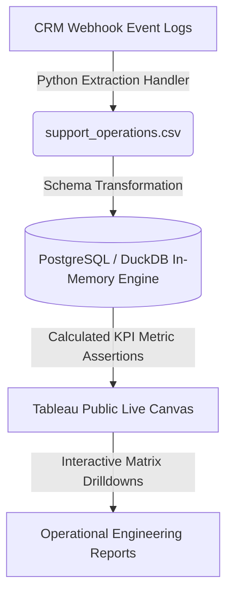

# Project 2: Customer Support SLA & Ticket Escalation Tracker

## 🏢 Architectural Core: Why This Project Was Built
1. **Preventing Contract Revenue Leakage:** In B2B SaaS platforms (like Freshworks or Zoho), missing a P1-Critical ticket Service Level Agreement (SLA) results in direct financial penalties and customer churn. 
2. **Eliminating Engineering Guesswork:** Software development teams cannot read 30,000 raw text logs to find system bugs. This engine extracts structural data to isolate which microservice modules are actively failing.
3. **Optimizing Workforce Allocation:** By tracking resolution speeds, support managers can accurately staff helpdesk shifts during peak ticket backlog waves.

---

## 🧠 Strategic Support Analytics Questions & Solutions

### Question 1: Which engineering modules cause the most critical SLA violations?
*   **The Business Goal:** Pinpoint which microservices have the highest rate of service level breaches, letting development teams fix the underlying software bugs before clients cancel contracts.
*   **The SQL Solution:**
    ```sql
    SELECT 
        issue_category,
        COUNT(ticket_id) as critical_incidents,
        SUM(sla_violated_flag) as total_breaches,
        ROUND((SUM(sla_violated_flag)::NUMERIC / COUNT(ticket_id)) * 100, 2) as breach_rate_pct
    FROM support_operations
    WHERE priority_tier IN ('P1-Critical', 'P2-High')
    GROUP BY issue_category
    ORDER BY breach_rate_pct DESC;
    ```

---

### Question 2: What is our active resolution speed benchmark by category?
*   **The Business Goal:** Track which software failure types require the longest average time to clear. This allows support managers to assign senior engineers to bottleneck categories.
*   **The SQL Solution:**
    ```sql
    SELECT 
        issue_category,
        ROUND(AVG(resolution_hours), 2) as avg_resolution_hours
    FROM support_operations
    WHERE status IN ('Resolved', 'Closed')
    GROUP BY issue_category
    ORDER BY avg_resolution_hours DESC;
    ```

---

### Question 3: How do outstanding ticket waves impact team resource capacity?
*   **The Business Goal:** Visualize active ticket build-up waves chronologically to ensure support operations can appropriately staff technical rotations during volume surges.
*   **The SQL Solution:**
    ```sql
    SELECT 
        DATE_TRUNC('month', CAST(created_at AS DATE)) as incident_month,
        COUNT(CASE WHEN status IN ('Open', 'Escalated') THEN 1 END) as active_backlog_volume
    FROM support_operations
    GROUP BY 1
    ORDER BY 1 ASC;
    ```

---

### Question 4: [NEW] What is the volume-to-breach ratio across support tiers?
*   **The Business Goal:** Determine if SLA breaches are caused by an overwhelming volume of tickets or poor agent response efficiency under normal conditions.
*   **The SQL Solution:**
    ```sql
    SELECT 
        priority_tier,
        COUNT(ticket_id) as total_volume,
        SUM(sla_violated_flag) as total_breaches,
        ROUND((SUM(sla_violated_flag)::NUMERIC / COUNT(ticket_id)) * 100, 2) as breach_velocity_pct
    FROM support_operations
    GROUP BY 1
    ORDER BY total_volume DESC;
    ```

---

### Question 5: [NEW] Identify peak failure hours for system stability audits.
*   **The Business Goal:** Extract the exact hour of the day when critical support tickets spike. This assists DevOps teams in mapping application crashes to automated deployment or cron job schedules.
*   **The SQL Solution:**
    ```sql
    SELECT 
        EXTRACT(HOUR FROM CAST(created_at AS TIMESTAMP)) as incident_hour,
        COUNT(ticket_id) as critical_p1_volume
    FROM support_operations
    WHERE priority_tier = 'P1-Critical'
    GROUP BY 1
    ORDER BY critical_p1_volume DESC;
    ```

---

## 📐 Data Infrastructure Map


---

## 🎨 Enterprise Support Dashboard Interactive Storyboard

Below is the complete user-driven walkthrough of the Tableau operational intelligence engine, tracking real-time microservice stability and helpdesk response efficiency:

### 1. Global Support System Baseline Overview
*Provides a consolidated view of incoming incident volumes, active infrastructure backlogs, and global SLA compliance metrics.*


### 2. Microservice Outage Isolation (API Timeouts)
*Demonstrates cross-filtering functionality by isolating the API Timeout module to evaluate backend server response delays.*


### 3. Severity Level Risk Audit (P1-Critical)
*Filters the entire operational workspace to track mission-critical tickets actively blocking clients.*


### 4. Transactional Blockage Matrix (Payment Failures)
*Isolates transaction-blocking categories to track average resolution speeds and prevent pipeline disruptions.*
